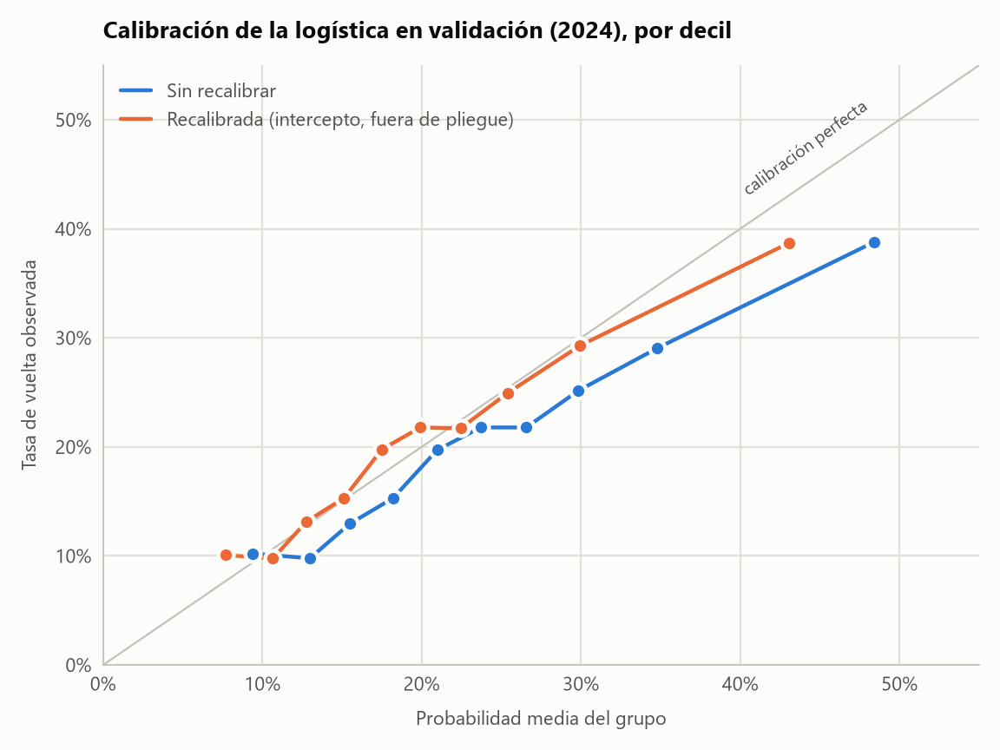

# Recalibración · logística día 0 · validación (cohorte 2024)

Generado por `modelo/recalibrar.py` el 2026-11-19. Tabla `77b71c49b21d…`. 13.595 clientes de validación. El bloque de prueba no se usó.

**Cómo se midió.** La logística se entrenó con 2023 (C = 0,1, el de la escalera). Cada método de recalibración se evaluó con validación cruzada de 5 pliegues dentro de validación: cada cliente recibe una probabilidad recalibrada con un ajuste que no lo vio. Intervalos: bootstrap pareado del 95% (2000 remuestreos).

**Criterio, fijado antes de ver los resultados:** menor log-loss fuera de pliegue; si un método más simple no es peor con intervalo del 95%, el más simple (orden: identidad, intercepto, platt, isotonica).

## Los cuatro métodos, fuera de pliegue

| Método | Log-loss | Brier | ECE | Prob. media | Pendiente | Intercepto | PR-AUC | ROC-AUC | Lift 20% |
|---|---|---|---|---|---|---|---|---|---|
| Sin recalibrar | 0,4857 [0,4775; 0,4948] | 0,1556 [0,1521; 0,1594] | 0,0375 [0,0314; 0,0442] | 24,0% | 0,89 | -0,34 | 0,340 | 0,648 | 1,66 |
| Intercepto | 0,4817 [0,4722; 0,4922] | 0,1539 [0,1500; 0,1581] | 0,0142 [0,0117; 0,0228] | 20,4% | 0,89 | -0,14 | 0,340 | 0,649 | 1,66 |
| Platt | 0,4815 [0,4722; 0,4917] | 0,1539 [0,1500; 0,1580] | 0,0110 [0,0087; 0,0196] | 20,4% | 1,00 | -0,00 | 0,340 | 0,648 | 1,66 |
| Isotónica | 0,4826 [0,4725; 0,4934] | 0,1537 [0,1498; 0,1578] | 0,0065 [0,0061; 0,0160] | 20,4% | 0,91 | -0,11 | 0,332 | 0,647 | 1,65 |

Tasa de vuelta observada: 20,4%. ECE: distancia promedio entre probabilidad y tasa observada en cada decil. Pendiente e intercepto: regresión logística de la vuelta sobre logit(p); calibración perfecta es pendiente 1 e intercepto 0.

## Diferencias

Negativo = el primero es mejor. *Sí* = el intervalo no incluye el cero.

| Comparación | Log-loss | Brier | ECE |
|---|---|---|---|
| Intercepto − Sin recalibrar | -0,0039 [-0,0054; -0,0024] · sí | -0,0017 [-0,0022; -0,0011] · sí | -0,0233 [-0,0278; -0,0130] · sí |
| Platt − Sin recalibrar | -0,0042 [-0,0057; -0,0027] · sí | -0,0017 [-0,0024; -0,0011] · sí | -0,0265 [-0,0309; -0,0162] · sí |
| Isotónica − Sin recalibrar | -0,0031 [-0,0064; 0,0019] · no | -0,0019 [-0,0026; -0,0012] · sí | -0,0309 [-0,0341; -0,0185] · sí |
| Sin recalibrar − Platt | 0,0042 [0,0027; 0,0057] · sí | 0,0017 [0,0011; 0,0024] · sí | 0,0265 [0,0162; 0,0309] · sí |
| Intercepto − Platt | 0,0003 [-0,0002; 0,0008] · no | 0,0001 [-0,0001; 0,0002] · no | 0,0032 [-0,0005; 0,0062] · no |
| Isotónica − Platt | 0,0011 [-0,0015; 0,0059] · no | -0,0002 [-0,0005; 0,0002] · no | -0,0045 [-0,0088; 0,0030] · no |

## Elegido: Intercepto

Menor log-loss: Platt. Ajustado con toda la validación: sigmoide(logit(p) − 0,2229). Los parámetros están en `calibracion_validacion.json` y se aplican a la prueba sin volver a ajustar.

## Por decil

| Grupo | Sin recalibrar: prob. media | Vuelven | Recalibrada: prob. media | Vuelven |
|---|---|---|---|---|
| 1 | 9,4% | 10,2% | 7,7% | 10,1% |
| 2 | 13,0% | 9,8% | 10,7% | 9,8% |
| 3 | 15,5% | 12,9% | 12,8% | 13,2% |
| 4 | 18,2% | 15,3% | 15,1% | 15,3% |
| 5 | 21,0% | 19,7% | 17,5% | 19,8% |
| 6 | 23,7% | 21,8% | 19,9% | 21,8% |
| 7 | 26,6% | 21,8% | 22,4% | 21,7% |
| 8 | 29,8% | 25,2% | 25,4% | 24,9% |
| 9 | 34,8% | 29,1% | 29,9% | 29,3% |
| 10 | 48,4% | 38,8% | 43,1% | 38,7% |

**Límite.** El calibrador se ajustó con 2024 y supone que 2025 se le parece. Si la carga de datos de contacto siguió cambiando, la prueba lo va a mostrar.
