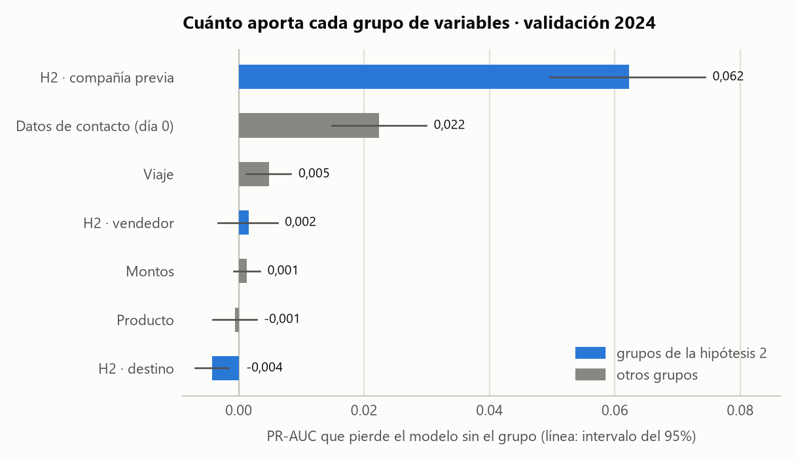
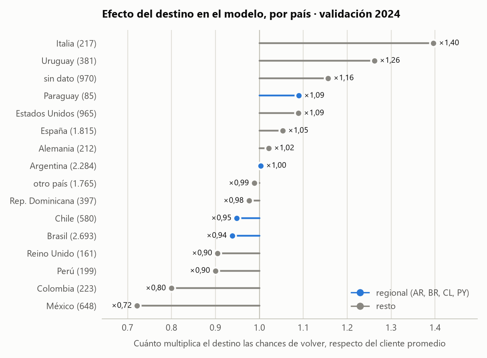

# Hipótesis 2 · interpretación de la logística día 0 · validación (cohorte 2024)

Generado por `modelo/interpretar.py` el 2026-11-19. Tabla `77b71c49b21d…`. 13.595 clientes de validación. El bloque de prueba no se usó. Todas las variantes son la misma logística (C = 0,1) entrenada con 2023; intervalos bootstrap pareados del 95% (2000 remuestreos). SHAP se lee como asociación, no como causa.

## 1. Cuánto aporta cada grupo

«Sin el grupo»: cuánto empeora el modelo si se lo vuelve a entrenar sin esas variables (lo que el grupo aporta y ningún otro grupo reemplaza). «Solo el grupo»: cuánto ordena por su cuenta. SHAP: contribución media, en valor absoluto, al logit de cada cliente.

| Grupo | Variables | Pierde sin él: PR-AUC | ROC-AUC | Log-loss | Solo el grupo: PR-AUC | ROC-AUC | SHAP medio |
|---|---|---|---|---|---|---|---|
| H2 · compañía previa | 4 | 0,062 [0,050; 0,074] | 0,031 [0,026; 0,037] | 0,0116 [0,0091; 0,0140] | 0,288 [0,274; 0,303] | 0,579 [0,568; 0,590] | 0,198 |
| Datos de contacto (día 0) | 4 | 0,022 [0,015; 0,030] | 0,046 [0,037; 0,055] | 0,0063 [0,0036; 0,0091] | 0,262 [0,252; 0,273] | 0,613 [0,602; 0,623] | 0,405 |
| Viaje | 4 | 0,005 [0,001; 0,008] | 0,004 [0,001; 0,008] | 0,0013 [0,0002; 0,0023] | 0,229 [0,219; 0,241] | 0,543 [0,531; 0,555] | 0,162 |
| H2 · vendedor | 4 | 0,002 [-0,003; 0,006] | 0,001 [-0,003; 0,005] | -0,0012 [-0,0024; 0,0001] | 0,226 [0,215; 0,238] | 0,532 [0,519; 0,544] | 0,148 |
| Montos | 3 | 0,001 [-0,001; 0,003] | 0,001 [-0,000; 0,002] | 0,0004 [0,0000; 0,0009] | 0,225 [0,214; 0,237] | 0,527 [0,515; 0,539] | 0,055 |
| Producto | 8 | -0,001 [-0,004; 0,003] | -0,002 [-0,005; 0,000] | -0,0001 [-0,0010; 0,0008] | 0,217 [0,207; 0,228] | 0,524 [0,512; 0,535] | 0,128 |
| H2 · destino | 2 | -0,004 [-0,007; -0,002] | -0,002 [-0,004; 0,000] | -0,0011 [-0,0018; -0,0004] | 0,214 [0,204; 0,224] | 0,515 [0,503; 0,527] | 0,092 |

Modelo completo: PR-AUC 0,340 [0,323; 0,357], ROC-AUC 0,648 [0,637; 0,660]. Prevalencia en validación: PR-AUC de referencia 0,204. En log-loss, la columna muestra cuánto *sube* sin el grupo (positivo = el grupo ayuda).

## 2. Compañía previa

Odds ratio: cuánto multiplica las chances de volver tener ese valor contra «0», con el resto de las variables fijas (coeficientes de la logística). SHAP medio: contribución media de la variable para los clientes con ese valor, en la escala logit.

| Variable | Valor | Clientes | Vuelven | Odds ratio vs 0 | SHAP medio |
|---|---|---|---|---|---|
| Viajó antes como acompañante | 0 | 11.326 | 17,7% | ×1,00 | -0,076 |
| Viajó antes como acompañante | 1 | 2.269 | 34,2% | ×1,66 | 0,433 |
| Viajes previos como acompañante | 0 | 11.326 | 17,7% | ×1,00 | -0,016 |
| Viajes previos como acompañante | 1 | 1.504 | 27,1% | ×0,91 | -0,115 |
| Viajes previos como acompañante | 2 | 417 | 37,4% | ×1,29 | 0,242 |
| Viajes previos como acompañante | 3+ | 348 | 60,9% | ×2,54 | 0,917 |
| Viaja con un cliente previo | 0 | 10.595 | 19,4% | ×1,00 | -0,003 |
| Viaja con un cliente previo | 1 | 3.000 | 24,2% | ×1,02 | 0,013 |
| Viaja con alguien con historial | 0 | 9.806 | 19,0% | ×1,00 | -0,041 |
| Viaja con alguien con historial | 1 | 3.789 | 24,1% | ×1,19 | 0,129 |

## 3. Destino

Efecto del destino (país y región juntos) por país, como multiplicador de las chances respecto del cliente promedio: exp(SHAP medio). Solo países con 50 clientes o más en validación.

| País | Regional | Clientes | Vuelven | Multiplicador |
|---|---|---|---|---|
| Italia |  | 217 | 21,2% | ×1,40 |
| Uruguay |  | 381 | 17,3% | ×1,26 |
| sin dato |  | 970 | 20,8% | ×1,16 |
| Paraguay | sí | 85 | 14,1% | ×1,09 |
| Estados Unidos |  | 965 | 23,9% | ×1,09 |
| España |  | 1.815 | 20,7% | ×1,05 |
| Alemania |  | 212 | 16,5% | ×1,02 |
| Argentina | sí | 2.284 | 19,6% | ×1,00 |
| otro país |  | 1.765 | 22,8% | ×0,99 |
| Rep. Dominicana |  | 397 | 18,6% | ×0,98 |
| Chile | sí | 580 | 17,8% | ×0,95 |
| Brasil | sí | 2.693 | 20,5% | ×0,94 |
| Reino Unido |  | 161 | 16,1% | ×0,90 |
| Perú |  | 199 | 15,1% | ×0,90 |
| Colombia |  | 223 | 15,2% | ×0,80 |
| México |  | 648 | 22,2% | ×0,72 |

Regional (AR, BR, CL, PY): 5.642 clientes, vuelven 19,7%, multiplicador medio ×0,97. Resto con país conocido: 5.218 clientes, vuelven 20,3%, ×1,01.

| Comparación | PR-AUC | ROC-AUC |
|---|---|---|
| completo − destino como regional sí/no | -0,004 [-0,007; -0,002] | -0,002 [-0,004; 0,000] |
| destino como regional sí/no − sin · H2 · destino | -0,000 [-0,000; 0,000] | -0,000 [-0,000; 0,000] |

«Destino como regional sí/no» reemplaza país y región por una sola marca regional, que es como está formulada H2. La segunda fila dice si esa marca aporta algo frente a no tener destino.

## 4. Vendedor

No se listan ni se ordenan vendedores. 133 códigos en validación; 346 clientes en `V-otros` (vendedores con menos de 50 clientes en la tabla).

- Sin el código de vendedor (con antigüedad y cartera): PR-AUC 0,001 [-0,004; 0,006], ROC-AUC 0,000 [-0,004; 0,005].
- Cuánto multiplica el vendedor las chances de su cliente, respecto del promedio: percentil 10 ×0,82, mediana ×1,02, percentil 90 ×1,36 (contribución del código, escala logit exponenciada).

## 5. Las variables una por una

Contribución media, en valor absoluto, al logit (SHAP). Las 12 primeras.

| Variable | SHAP medio |
|---|---|
| d0_tiene_mail | 0,374 |
| vendedor | 0,143 |
| fue_acompaniante_antes | 0,136 |
| d0_tiene_nacimiento | 0,115 |
| region_destino | 0,112 |
| anticipacion | 0,104 |
| venta_usd | 0,095 |
| servicios | 0,085 |
| pasajeros | 0,084 |
| aerolinea | 0,077 |
| noches | 0,075 |
| pais_destino | 0,071 |
