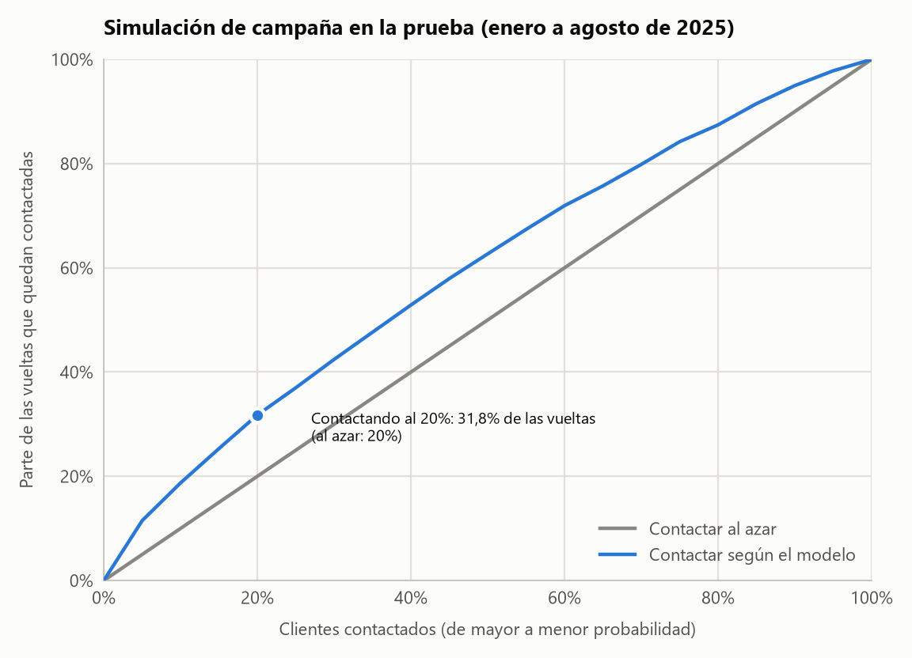

# Prueba · enero a agosto de 2025

Generado por `modelo/prueba.py` el 2026-11-19, siguiendo [`docs/plan_de_la_prueba.md`](../../docs/plan_de_la_prueba.md) (commit `69632ac`, 2026-11-19). Tabla `77b71c49b21d…`. 10.148 clientes; vuelve el 20,8%. Intervalos bootstrap pareados del 95% (2000 remuestreos). Esta evaluación se corre una sola vez.

## Hipótesis 1: confirmada

Criterio del plan: la logística principal le gana a la prevalencia y a la regla «viajó antes como acompañante» en PR-AUC y ROC-AUC, con el intervalo entero por encima de cero.

| Comparación | Métrica | Diferencia | ¿Gana? |
|---|---|---|---|
| Logística principal (recalibrada) − Prevalencia | PR-AUC | 0,111 [0,096; 0,129] | sí |
| Logística principal (recalibrada) − Prevalencia | ROC-AUC | 0,120 [0,106; 0,133] | sí |
| Logística principal (recalibrada) − Regla: viajó antes como acompañante | PR-AUC | 0,077 [0,064; 0,090] | sí |
| Logística principal (recalibrada) − Regla: viajó antes como acompañante | ROC-AUC | 0,053 [0,042; 0,065] | sí |

## Todos los modelos en la prueba

| Modelo | PR-AUC | ROC-AUC | Lift 10% | Lift 20% | Captura 20% | Brier | Prob. media |
|---|---|---|---|---|---|---|---|
| Prevalencia | 0,208 [0,200; 0,216] | 0,500 [0,500; 0,500] | 1,00 | 1,00 [1,00; 1,00] | 20,0% | 0,1647 [0,1601; 0,1692] | 21,9% |
| Regla: primer viaje de 10 mil o más | 0,206 [0,198; 0,215] | 0,494 [0,488; 0,500] | 0,91 | 0,96 [0,92; 1,00] | 19,2% | 0,1649 [0,1603; 0,1694] | 21,9% |
| Regla: viajó antes como acompañante | 0,243 [0,231; 0,254] | 0,566 [0,556; 0,576] | 1,61 | 1,51 [1,43; 1,59] | 30,1% | 0,1616 [0,1571; 0,1663] | 22,3% |
| **Logística principal (recalibrada)** | 0,319 [0,301; 0,339] | 0,620 [0,606; 0,633] | 1,87 | 1,59 [1,50; 1,67] | 31,8% | 0,1595 [0,1554; 0,1640] | 23,9% |
| Logística principal sin recalibrar | 0,319 [0,301; 0,339] | 0,620 [0,606; 0,633] | 1,87 | 1,59 [1,50; 1,67] | 31,8% | 0,1641 [0,1605; 0,1679] | 27,9% |
| Logística reducida (recalibrada) | 0,319 [0,301; 0,338] | 0,628 [0,615; 0,641] | 1,84 | 1,58 [1,50; 1,67] | 31,6% | 0,1585 [0,1542; 0,1629] | 23,5% |
| CatBoost día 0 | 0,312 [0,294; 0,332] | 0,614 [0,600; 0,627] | 1,85 | 1,53 [1,44; 1,61] | 30,5% | 0,1643 [0,1607; 0,1682] | 27,2% |
| Logística ficha única | 0,321 [0,303; 0,340] | 0,624 [0,609; 0,637] | 1,86 | 1,59 [1,50; 1,68] | 31,8% | 0,1592 [0,1551; 0,1635] | 24,5% |
| Logística sin datos de contacto | 0,305 [0,286; 0,324] | 0,591 [0,577; 0,605] | 1,81 | 1,52 [1,44; 1,60] | 30,4% | 0,1606 [0,1562; 0,1653] | 22,5% |
| Logística entrenada con 2023 + 2024 | 0,332 [0,313; 0,352] | 0,638 [0,625; 0,651] | 1,90 | 1,60 [1,52; 1,69] | 31,9% | 0,1578 [0,1537; 0,1622] | 23,9% |

## Comparaciones declaradas

Diferencia «primero − segundo». En Brier y log-loss, negativo = el primero es mejor. *Sí* = el intervalo no incluye el cero.

| Comparación | PR-AUC | ROC-AUC | Lift 20% | Brier | Log-loss |
|---|---|---|---|---|---|
| Logística principal (recalibrada) − Prevalencia | 0,111 [0,096; 0,129] · sí | 0,120 [0,106; 0,133] · sí | 0,588 [0,499; 0,670] · sí | -0,0053 [-0,0071; -0,0033] · sí | -0,0150 [-0,0196; -0,0104] · sí |
| Logística principal (recalibrada) − Regla: viajó antes como acompañante | 0,077 [0,064; 0,090] · sí | 0,053 [0,042; 0,065] · sí | 0,083 [0,006; 0,151] · sí | -0,0021 [-0,0035; -0,0007] · sí | -0,0062 [-0,0096; -0,0025] · sí |
| Regla: viajó antes como acompañante − Prevalencia | 0,035 [0,028; 0,042] · sí | 0,066 [0,056; 0,076] · sí | 0,506 [0,426; 0,586] · sí | -0,0032 [-0,0043; -0,0020] · sí | -0,0088 [-0,0117; -0,0059] · sí |
| Regla: primer viaje de 10 mil o más − Prevalencia | -0,002 [-0,003; 0,000] | -0,006 [-0,012; 0,000] | -0,040 [-0,081; 0,002] | 0,0002 [0,0001; 0,0003] · sí | 0,0005 [0,0002; 0,0008] · sí |
| Logística reducida (recalibrada) − Logística principal (recalibrada) | 0,000 [-0,007; 0,008] | 0,009 [0,000; 0,017] · sí | -0,008 [-0,071; 0,061] | -0,0010 [-0,0018; -0,0002] · sí | -0,0026 [-0,0047; -0,0006] · sí |
| CatBoost día 0 − Logística principal (recalibrada) | -0,007 [-0,016; 0,002] | -0,006 [-0,015; 0,004] | -0,062 [-0,134; 0,017] | 0,0048 [0,0036; 0,0061] · sí | 0,0119 [0,0088; 0,0150] · sí |
| Logística ficha única − Logística principal (recalibrada) | 0,002 [-0,003; 0,008] | 0,004 [-0,002; 0,011] | 0,001 [-0,050; 0,066] | -0,0003 [-0,0009; 0,0004] | -0,0006 [-0,0025; 0,0012] |
| Logística principal (recalibrada) − Logística sin datos de contacto | 0,014 [0,008; 0,020] · sí | 0,028 [0,020; 0,036] · sí | 0,066 [0,005; 0,118] · sí | -0,0011 [-0,0018; -0,0004] · sí | -0,0042 [-0,0063; -0,0021] · sí |
| Logística entrenada con 2023 + 2024 − Logística principal (recalibrada) | 0,013 [0,007; 0,019] · sí | 0,019 [0,011; 0,026] · sí | 0,007 [-0,046; 0,082] | -0,0017 [-0,0024; -0,0009] · sí | -0,0047 [-0,0066; -0,0028] · sí |
| Logística principal (recalibrada) − Logística principal sin recalibrar | 0,000 [0,000; 0,000] | 0,000 [0,000; 0,000] | 0,000 [0,000; 0,000] | -0,0046 [-0,0052; -0,0039] · sí | -0,0113 [-0,0131; -0,0095] · sí |

## Calibración en la prueba

| Modelo | Prob. media | Vuelve | ECE | Pendiente |
|---|---|---|---|---|
| Logística principal (recalibrada) | 23,9% | 20,8% | 0,0322 | 0,84 |
| Logística principal sin recalibrar | 27,9% | 20,8% | 0,0710 | 0,84 |
| Logística reducida (recalibrada) | 23,5% | 20,8% | 0,0271 | 0,94 |

| Decil | Principal: prob. media | Vuelven | Reducida: prob. media | Vuelven |
|---|---|---|---|---|
| 1 | 11,1% | 10,4% | 12,5% | 10,6% |
| 2 | 15,0% | 15,7% | 15,6% | 14,0% |
| 3 | 17,2% | 15,8% | 17,5% | 14,8% |
| 4 | 19,1% | 16,5% | 19,8% | 16,4% |
| 5 | 21,0% | 19,2% | 21,3% | 17,4% |
| 6 | 23,0% | 20,4% | 22,6% | 21,7% |
| 7 | 25,3% | 21,7% | 24,0% | 23,0% |
| 8 | 27,9% | 22,3% | 25,9% | 24,3% |
| 9 | 32,3% | 27,0% | 30,0% | 27,3% |
| 10 | 46,8% | 39,0% | 45,8% | 38,4% |

## Simulación de campaña

Contactar al 20% de clientes con mayor probabilidad (2.030 de 10.148): entre ellos están 670 de los 2.109 que vuelven (31,8%), contra 422 si se contacta a la misma cantidad al azar. Vuelve el 33,0% de los contactados, 1,59 veces el promedio.

Ordenando por probabilidad × utilidad de la primera compra: quedan contactados 474 de los que vuelven (22,5%) y el 67,5% de la utilidad de primera compra de quienes vuelven (ordenando solo por probabilidad: 38,8%; al azar: 20%).

**Límites.** Mide propensión, no efecto: cuenta a quienes iban a volver y quedaron contactados. La tabla no trae la utilidad del viaje de vuelta; el valor se mide por la primera compra.
